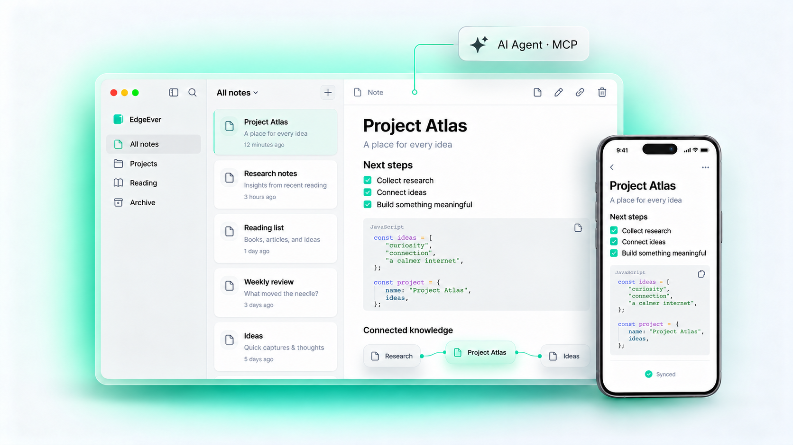

<div align="center">
  <h1>
     StillNote
  </h1>
  <p>
    <b>An open-source personal knowledge base &amp; three-pane notes workspace — featuring Editorial Flow UI, Editorial Pine branding, metadata-first mobile notebook sync, and fluid touch gestures. Free on Cloudflare or self-hosted via Docker.</b>
  </p>
  <p>
    <a href="https://github.com/CottonChou/stillnote/releases/latest"></a>
    <a href="https://github.com/CottonChou/stillnote/stargazers"></a>
    <a href="https://github.com/CottonChou/stillnote/blob/main/LICENSE"></a>
    <a href="https://stillnote.org"></a>
  </p>
  <p>
    <a href="README.zh-CN.md">简体中文</a> | <a href="README.zh-TW.md">繁體中文</a> | <b>English</b> | <a href="README.ja.md">日本語</a> | <a href="README.pl-PL.md">Polski</a>
  </p>
  <p>
    <a href="#downloads">📦 MAC &amp; APK Downloads</a> &nbsp;|&nbsp;
    <a href="#whats-new-in-editorial-flow-edition">✨ Editorial Flow &amp; Enhancements</a> &nbsp;|&nbsp;
    <a href="#features">🧩 Feature Matrix</a> &nbsp;|&nbsp;
    <a href="#deployment">☁️ Deployment</a> &nbsp;|&nbsp;
    <a href="#developer-guide--local-packaging">🛠️ Local Packaging</a>
  </p>
  <p align="center">
    
  </p>
</div>

StillNote preserves the proven three-pane productivity workflow (**Notebooks · Note List · Editor**) with instant multi-device sync, local SQLite offline resilience, and native AI Agent integration (MCP &amp; ACP) — while allowing zero-cost serverless hosting on Cloudflare or self-hosting via Docker.

---

<a id="whats-new-in-editorial-flow-edition"></a>
## ✨ Editorial Flow Highlights (`v2.17.0`)

Beyond core note-taking, migration, and AI agent capabilities, StillNote refines typography, cross-platform visual calm, branding, and touch ergonomics:

- **Editorial Flow Reading-First UI**: Web, macOS desktop, and Expo / React Native mobile clients adopt a warm cotton paper palette (`#f4f1ea` / `#f9f7f2` / `#fdfcf9`), charcoal dark mode (`#151513` / `#1d1c1a` / `#22211e`), and editorial pine accents (`#187958` / `#43b88c`). Desktop `BrowserWindow` startup backgrounds sync with `nativeTheme` (`apps/desktop/src/main/index.mjs`) to eliminate cold-start flash, and the note header places Share cleanly in the `...` menu alongside a one-click Close Note button.
- **Editorial Pine Bookmark Folio Icon**: Unified across macOS (`icon.icns` + 1x/2x `trayTemplate` menu bar glyphs), Android (`#187958` adaptive icon &amp; splash screen), iOS asset slots, Web/PWA manifests, Astro site favicons, browser extensions, and login screens.
- **Fluid Mobile Touch Gestures &amp; Fast Notebook Sync** *(detailed in [`docs/mobile-features.md`](docs/mobile-features.md))*:
  - **DrawerLayout Swipe Navigation**: Smooth gesture-driven notebook drawer with instant search, inline folder creation, single/all notebook sync (`Sync Notebook`), and Android back-gesture safety (`WorkspaceDrawer.tsx`).
  - **Metadata-First Lazy Sync**: Pulls lightweight notebook &amp; note metadata first and loads full note contents on demand for fast synchronization.
  - **Swipe Left Card Actions**: Swipe any note card left for one-tap **Star / Unstar** or **Delete** with Trash confirmation guard (`WorkspaceNotesView.tsx`).
  - **Cross-Note Fullscreen Image Swipe**: Swiping past the first or last image seamlessly transitions to the previous/next note containing images and syncs list selection upon exit (`ZoomableImagePreview.tsx`).

---

<a id="downloads"></a>
## 📦 Downloads (macOS DMG &amp; Android APK)

### Official Releases

Pre-built binaries across all supported platforms are published under [StillNote Releases](https://github.com/CottonChou/stillnote/releases/latest):

| Platform | Architecture | Format | Notes |
| :--- | :--- | :--- | :--- |
| **macOS** | Apple Silicon (`arm64`) | `.dmg` / `.zip` | Includes Rust SQLite sidecar, menu bar tray glyphs &amp; `StillNoteShare.appex` (ad-hoc signed; right-click → Open or clear quarantine on first launch) |
| **Android** | `arm64-v8a` | `.apk` | Standalone release-signed APK (`org.stillnote.mobile`) with Hermes engine &amp; `#187958` adaptive icon |

<p>
  <a href="https://github.com/CottonChou/stillnote/releases/latest"></a>&nbsp;&nbsp;
  <a href="https://github.com/CottonChou/stillnote/releases/latest"></a>&nbsp;&nbsp;
  <a href="https://github.com/CottonChou/stillnote/releases/latest"></a>&nbsp;&nbsp;
  <a href="https://github.com/CottonChou/stillnote/releases/latest"></a>&nbsp;&nbsp;
  <a href="https://apps.apple.com/us/app/stillnote/id6792625631"></a>
</p>

> All desktop and Android release checks point directly to [`CottonChou/stillnote`](https://github.com/CottonChou/stillnote/releases/latest).

### Browser Web Clipper Extension

<p>
  <a href="https://chromewebstore.google.com/detail/stillnote-web-clipper/gjadpfmanienmlofajibkfkkpfdkclgo"></a>&nbsp;&nbsp;
  <a href="https://chromewebstore.google.com/detail/stillnote-web-clipper/gjadpfmanienmlofajibkfkkpfdkclgo"></a>&nbsp;&nbsp;
  <a href="https://addons.mozilla.org/firefox/addon/stillnote-web-clipper/"></a>
</p>

- Extract clean Markdown or selected regions directly into your self-hosted StillNote instance.
- Structured capture for 20+ platforms including X, Xiaohongshu, WeChat, Zhihu, Reddit, GitHub, YouTube, Bilibili, Substack, Hacker News, and podcasts.

---

## Why StillNote

- **Truly Open &amp; Serverless-Capable**: Runs cleanly within Cloudflare Workers + D1 + R2 free tiers or via a single Docker container on your NAS/VPS.
- **Fast at Scale**: Three-tier persistence (`content_json` + `content_markdown` + `content_text`) keeps 10,000+ notes snappy for editing, search, and API/MCP automation.
- **No Lock-In**: Standard SQLite storage, lossless StillNote ZIP archive backup, and native Evernote / Obsidian / Joplin / flomo / Memos migration.

<a id="features"></a>
## 🧩 Feature Matrix

| Module | Core Capabilities | Highlights |
| :--- | :--- | :--- |
| **Writing &amp; Reading** | Three-pane workspace, TipTap WYSIWYG &amp; raw Markdown toggle, math/code blocks, auto-save, revision history | **Editorial Flow paper/charcoal themes**, native Poster Notes, WeChat formatter, MD/HTML/PDF export |
| **Organization &amp; Search** | Infinite notebook trees, tags, drag sorting, batch merge/move, full-text search | **One-click static knowledge-base publishing** with tree nav &amp; optional password/expiry controls |
| **Capture &amp; Media** | Multi-format attachments, client-side image compression (up to 1 GiB chunked streaming), mobile share extension | **WeChat chat transcript archival**, 20+ platform clipper, cross-note fullscreen image swipe |
| **Data &amp; Diagrams** | Native tables, Markdown tables, Mermaid flow/sequence/architecture diagrams | **AI Multi-Dimensional Tables**, public collection forms, AI diagrams &amp; infographics |
| **AI &amp; Protocols** | Companion AI sidebar (BYOK: OpenAI / Claude / Gemini / custom endpoints) | **Remote MCP &amp; Desktop ACP** for external/local coding agents, AI RSS daily digests, plugin API |
| **Sync &amp; Storage** | Web, PWA, macOS, Windows, Linux, iOS, Android; offline-first outbox &amp; incremental sync | **Zero-server Cloudflare tier** or **Docker (`amd64` / `arm64`)**, multi-user workspaces, OSS/PicGo/CloudFlare ImgBed |

---

<a id="deployment"></a>
## ☁️ Deployment

Cloudflare is the recommended zero-server deployment. Docker is available for users who prefer a VPS, NAS, or home server.

### Option A: Deploy with an AI Agent (Recommended)

Copy the prompt below directly into an AI Agent (such as Codex, Claude, Cursor, WorkBuddy, Antigravity, OpenClaw, Hermes Agent, etc.):

```text
Deploy StillNote entirely through GitHub and Cloudflare:
1. Fork https://github.com/CottonChou/stillnote.
2. Create D1 `stillnote` and R2 `stillnote-resources` in Cloudflare.
3. In Workers & Pages, create a Worker named `stillnote` from the Fork's `main` branch.
   Use the repository root, keep Cloudflare's default Workers Builds deploy command,
   and ensure its API token can read and edit D1. Select Save and Deploy.
4. After the Worker is created, add the user's chosen password as the runtime Secret
   `STILLNOTE_AUTH_PASSWORD` (preferably at least 32 characters).
   The username defaults to `admin`.
   If the user specifies another, set `STILLNOTE_AUTH_USERNAME` as a Workers Builds
   variable before the next build.
5. Run the build again, verify `/api/health` and `/api/openapi.json`, then log in
   with that administrator username and password.
6. Enable and manually run the GitHub Actions workflow named `Update deployed StillNote`
   once so the Fork can automatically receive future stable releases and fixes.
```

> Detailed requirements: [AI Agent Cloudflare Deployment](docs/agent-deploy-cloudflare.md).

### Option B: Manual Online Deployment

<details>
<summary>📖 Click to expand: 6-Step Web Manual Deployment Guide</summary>

Complete setup in 6 web steps:

1. **Fork the Repository**: Click **Fork** at the top right of GitHub to fork StillNote into your personal account.
2. **Create Cloudflare Resources**: Create D1 `stillnote` and R2 `stillnote-resources`.
3. **Import & Configure the Project**: Create a Worker named `stillnote` from the Fork's `main` branch in Cloudflare **Workers & Pages**. Use the repository root and keep Cloudflare's default Workers Builds deploy command, which runs in Cloudflare. Ensure its API token can read and edit D1. The deploy command creates the bindings; do not edit Fork files.
4. **Choose the Administrator Password**: Choose an administrator password, preferably at least 32 characters. Once the Worker is created, save it as the runtime Secret `STILLNOTE_AUTH_PASSWORD`.
5. **Build & Verify**: Save and Deploy creates the Worker and starts a build. The initial build primarily initializes the Worker instance; if it fails due to missing administrator Secret, this is expected behavior. Simply add the runtime Secret `STILLNOTE_AUTH_PASSWORD` from Step 4 and click retry. The username defaults to `admin`; to use another, set `STILLNOTE_AUTH_USERNAME` as a Workers Builds variable before retrying. Once deployed, confirm `/api/health` returns `200`, then log in with the configured username and password.
6. **Enable Automatic Updates**: Open the Fork's **Actions** tab, click **I understand my workflows, go ahead and enable them**, then manually run **Update deployed StillNote** once so the Fork can automatically receive future stable releases and fixes.

> 📖 Full instructions: [Online Deployment Guide](docs/deploy-cloudflare-button.md).

</details>

### Option C: Docker on a VPS or NAS

Docker runs the same Hono/Zod API, Web UI, Remote MCP, and migrations using SQLite (`amd64` and `arm64`):

```sh
curl -fsSL https://stillnote.org/install.sh | bash
```

See [Deploy StillNote with Docker](docs/deploy-docker.md) for manual configuration and `~/stillnote/update.sh`.

---

<a id="developer-guide--local-packaging"></a>
## 🛠️ Developer Guide &amp; Local Packaging

### Local Development

```sh
bun install
bun run dev
```

Fresh local dev instances auto-sign in as `owner` / `stillnote-local-dev`.

### Regenerate Icons &amp; Package Native Clients

```sh
# Regenerate all platform icons from assets/brand/stillnote-icon.svg & stillnote-mark.svg
bun run prepare:brand:icons

# Build macOS Apple Silicon DMG / ZIP (requires arm64 Rust toolchain + Xcode)
bun run build:desktop

# Build signed Android arm64 APK using your local keystore (~/.config/stillnote/android/)
bun run build:android:apk:local
```

<details>
<summary>📁 Expand to view: Monorepo Architecture</summary>

```text
apps/web          Vite + React + PWA + Tailwind Editorial Flow UI
apps/desktop      Electron shell, tray glyphs, Rust sidecar & macOS Share Extension
apps/mobile       Expo + React Native Android app (SQLite mirror + gesture enhancements)
apps/ios          Native SwiftUI iOS client (TipTap EditorBundle + GRDB)
apps/api          Hono/Zod backend for Cloudflare Workers + D1/R2 or Docker Bun + SQLite
apps/extension    Manifest V3 Chrome / Edge / Firefox Web Clipper
apps/site         Astro marketing & documentation static site
packages/client   Shared API client
packages/shared   Shared Zod schemas, Markdown/TipTap converters, diagram canvas presets
crates/desktop-sidecar  Rust SQLite & resource service for Desktop
migrations        Append-only SQL migrations shared across D1 & SQLite
scripts           Icon generation, desktop/Android packaging & release utilities
```

</details>

---

## Community, Brand &amp; Legal

- **Repository**: [CottonChou/stillnote](https://github.com/CottonChou/stillnote) · [Issues](https://github.com/CottonChou/stillnote/issues) · [Telegram Group](https://t.me/+wwUx1BYLrIdiZjY1)
- **Brand &amp; Releases**: StillNote source code and releases for this edition are maintained at [`CottonChou/stillnote`](https://github.com/CottonChou/stillnote).
- **Disclaimer**: StillNote is independent open-source software unrelated to Evernote Corporation or its affiliates. Self-hosted users and instance operators bear sole responsibility for stored data.
