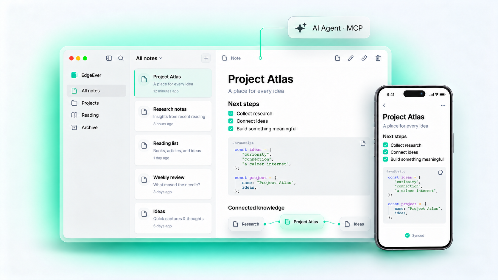

<div align="center">
  <h1>
     StillNote · Editorial Flow Edition
  </h1>
  <p>
    <b>开源个人 AI 原生知识库与三栏笔记工作区（<a href="https://github.com/CottonChou/stillnote">CottonChou/stillnote</a>，v2.17.0）—— 采用 Editorial Flow 极简文档流阅读风界面、松绿书签品牌图标、移动端元信息优先延迟同步与顺滑手势交互。支持 Cloudflare 零成本部署或 Docker 自托管。</b>
  </p>
  <p>
    <a href="https://github.com/CottonChou/stillnote/releases/latest"></a>
    <a href="https://github.com/CottonChou/stillnote/stargazers"></a>
    <a href="https://github.com/CottonChou/stillnote/blob/main/LICENSE"></a>
    <a href="https://stillnote.org"></a>
  </p>
  <p>
    <b>简体中文</b> | <a href="README.zh-TW.md">繁體中文</a> | <a href="README.md">English</a> | <a href="README.ja.md">日本語</a> | <a href="README.pl-PL.md">Polski</a>
  </p>
  <p>
    <a href="#downloads">📦 MAC 与 APK 下载</a> &nbsp;|&nbsp;
    <a href="#editorial-flow-自定义增强亮点">✨ Editorial Flow 与核心亮点</a> &nbsp;|&nbsp;
    <a href="#features">🧩 核心功能矩阵</a> &nbsp;|&nbsp;
    <a href="#部署">☁️ 在线与自部署</a> &nbsp;|&nbsp;
    <a href="#开发者指南与本地构建打包">🛠️ 本地打包指南</a>
  </p>
  <p align="center">
    
  </p>
</div>

StillNote 延续经典高效的三栏知识工作区（**目录树 · 笔记列表 · 编辑器**），支持端云秒级同步、SQLite 本地离线读写以及原生 AI Agent（MCP &amp; ACP）联动，可免费托管在 Cloudflare 配额内或通过 Docker 在 VPS / NAS 上私有化运行。

---

<a id="editorial-flow-自定义增强亮点"></a>
## ✨ Editorial Flow 与核心亮点（`v2.17.0`）

在完整集成多格式导入迁入、公开分享链接有效期/阅读计数、PicGo/CloudFlare ImgBed 图床与 AI 助手等能力的基础上，重点打磨了长时间写作视觉体验、全端品牌统一与移动端高频手势及同步性能：

- **Editorial Flow 极简文档流 UI 重构**：Web、macOS 桌面端与移动端统一换装低视觉噪点的暖棉纸浅色主题（`#f4f1ea` / `#f9f7f2` / `#fdfcf9`）与沉稳炭黑暗色模式（`#151513` / `#1d1c1a` / `#22211e`），搭配松石松绿（`#187958` / `#43b88c`）；Electron 窗口与原生配色同步（[index.mjs](apps/desktop/src/main/index.mjs)），消除冷启动闪烁；笔记顶部栏精简并将分享收纳至「更多」菜单，同时提供一键关闭当前笔记按钮。
- **Editorial Pine（`#187958`）书签纸页品牌图标**：全新绘制 StillNote 品牌主标与单色托盘符号，已全量生成并应用至 macOS `icon.icns`（Retina 1024）与 1x/2x 菜单栏 `trayTemplate` 图标、Android 自适应前景与 `#187958` 启动页、iOS 图标槽位、Web / PWA、官网与浏览器裁剪扩展，以及全端登录页徽标。
- **移动端顺滑手势与笔记本按需同步**（详见 [docs/FORK_CUSTOMIZATIONS.md](docs/FORK_CUSTOMIZATIONS.md)）：
  - **DrawerLayout 顺滑手势与防误退**：使用 `react-native-drawer-layout` 优化左滑收起抽屉手感，并加入系统返回键「再按一次退出 StillNote」二次确认（`WorkspaceDrawer.tsx`）；
  - **元信息优先与单本按需同步**：同步时优先拉取笔记本树与笔记标题索引，笔记正文在点击打开时再延迟加载，并支持手动一键同步单本或全部笔记本（`Sync Notebook`）；
  - **卡片左滑快捷操作**：单篇笔记卡片向左滑出「星标置顶 / 取消置顶」与「删除」按钮（`WorkspaceNotesView.tsx`）；
  - **跨笔记全屏连续看图**：全屏预览至当前笔记首/末张图片后继续滑动可平滑切入相邻图文笔记（`ZoomableImagePreview.tsx`）。

---

<a id="downloads"></a>
## 📦 下载客户端（MAC 与 Android APK）

### StillNote 发布产物（`CottonChou/stillnote`）

已集成 **Editorial Flow UI**、**Editorial Pine 书签纸页图标**、**移动端按需同步与手势体验优化**的 macOS / Android 成品包发布在 [CottonChou/stillnote Releases](https://github.com/CottonChou/stillnote/releases/latest)：

| 平台 | 架构 | 安装包格式 | 说明 |
| :--- | :--- | :--- | :--- |
| **macOS** | Apple Silicon (`arm64`) | `.dmg` / `.zip` | 内置原生 `arm64` Rust Sidecar、全新 Dock / 菜单栏图标与 `StillNoteShare.appex` 微信分享扩展（本地 Ad-hoc 签名，首次打开可在访达中右键「打开」） |
| **Android** | `arm64-v8a` | `.apk` | 生产签名独立离线安装包（`org.stillnote.mobile`），内置 Hermes 引擎、`#187958` 启动页与自适应图标 |

<p>
  <a href="https://github.com/CottonChou/stillnote/releases/latest"></a>&nbsp;&nbsp;
  <a href="https://github.com/CottonChou/stillnote/releases/latest"></a>&nbsp;&nbsp;
  <a href="https://github.com/CottonChou/stillnote/releases/latest"></a>&nbsp;&nbsp;
  <a href="https://github.com/CottonChou/stillnote/releases/latest"></a>&nbsp;&nbsp;
  <a href="https://apps.apple.com/us/app/stillnote/id6792625631"></a>
</p>

> 桌面端与 Android 客户端默认从 [`CottonChou/stillnote`](https://github.com/CottonChou/stillnote/releases/latest) 检查与获取更新。

### 浏览器网页裁剪插件

<p>
  <a href="https://chromewebstore.google.com/detail/stillnote-web-clipper/gjadpfmanienmlofajibkfkkpfdkclgo"></a>&nbsp;&nbsp;
  <a href="https://chromewebstore.google.com/detail/stillnote-web-clipper/gjadpfmanienmlofajibkfkkpfdkclgo"></a>&nbsp;&nbsp;
  <a href="https://addons.mozilla.org/zh-CN/firefox/addon/stillnote-web-clipper/"></a>
</p>

- 一键提取纯净正文为 Markdown 或精准剪藏选中区域与图片至自托管实例。
- 深度适配 20+ 主流内容平台：X、小红书、微信公众号、知乎、Reddit、GitHub、YouTube、Bilibili、Substack、Hacker News 与小宇宙播客等。

---

## 为什么选择 StillNote

- **Serverless 零成本运行**：可在 Cloudflare Workers + D1 + R2 免费额度内长期运行，也可用同一个镜像在 VPS / NAS 上通过 Docker 私有部署。
- **万条笔记依然轻快**：数据库同步维护 `content_json` / `content_markdown` / `content_text` 三种形态，兼顾编辑器响应、开放导出与毫秒级全文检索。
- **数据完全自主**：标准 SQLite 底座 + 无损 ZIP 备份还原，支持从印象笔记、Obsidian、Joplin、flomo 与 Memos 一键迁移（[最佳实践合集](docs/best-practices.zh-CN.md)）。

<a id="features"></a>
## 🧩 核心功能矩阵

| 模块 | 基础功能 | 进阶亮点 |
| :--- | :--- | :--- |
| **写作与阅读** | 经典三栏工作区、TipTap 所见即所得与 Markdown 双视图、数学公式、代码块、版本历史 | **Editorial Flow 纸感与深炭阅读模式**、原生海报笔记、微信公众号一键排版、MD/HTML/PDF 导出 |
| **组织与发布** | 无限层级笔记本树、标签体系、拖拽排序、批量合并/移动、全文检索 | **独立静态知识库站点发布**（支持访问密码、过期时间与访问计数控制） |
| **剪藏与附件** | 全格式附件分片上传（最高 1 GiB）、端侧静默压缩（省流 50%–90%） | **微信聊天记录一键归档**、20+ 平台结构化剪藏、移动端跨笔记全屏连续看图 |
| **数据与图表** | 原生表格、Markdown 表格、Mermaid 流程图/时序图/架构图 | **AI 多维表格**、免登录公开收集表单、AI 思维导图与信息图 |
| **AI 与生态** | 侧边栏 AI 助手（BYOK：OpenAI / Claude / Gemini / 自定义协议） | **Remote MCP + 桌面端 ACP 协议互联**、AI RSS 智能订阅日报、开放插件 API |
| **同步与部署** | Web / PWA / macOS / Windows / Linux / iOS / Android 离线优先增量同步 | **Cloudflare 免费托管**或 **Docker (`amd64`/`arm64`)**、多账号隔离、OSS/PicGo/CloudFlare ImgBed |

---

<a id="部署"></a>
## ☁️ 部署

Cloudflare 是推荐的零服务器部署方式；希望使用 VPS、NAS 或家庭服务器的用户也可以选择 Docker。

### 方案一：交给 AI Agent 部署（推荐）

将下方提示词直接复制发送给 AI Agent（如 Codex、Claude、Cursor、WorkBuddy、Antigravity、OpenClaw、Hermes Agent 等）：

```text
请全程通过 GitHub 和 Cloudflare 在线部署 StillNote：
1. Fork https://github.com/CottonChou/stillnote。
2. 在 Cloudflare 中创建 D1 `stillnote` 与 R2 `stillnote-resources`。
3. 在 Workers & Pages 中从 Fork 的 `main` 分支创建名为 `stillnote` 的 Worker。
   使用仓库根目录，保留 Cloudflare Workers Builds 的默认部署命令，确认其 API Token
   具备 D1 读取和编辑权限，然后保存并部署。
4. Worker 创建后，设置运行时 Secret `STILLNOTE_AUTH_PASSWORD`，值为用户指定的密码
   （建议至少 32 个字符）。管理员用户名默认为 `admin`；如需自定义，请在再次构建前
   设置 Workers Builds 构建变量 `STILLNOTE_AUTH_USERNAME`。
5. 再次构建，验证 `/api/health` 和 `/api/openapi.json`，再用该管理员
   用户名和密码验证登录。
6. 启用并手动运行一次名为 `Update deployed StillNote` 的 GitHub Actions 工作流，
   以便后续自动同步正式版本，持续获得 StillNote 的功能更新和问题修复。
```

> 详细约定与要求请查看：[AI Agent 在线部署约定](docs/agent-deploy-cloudflare.zh-CN.md)。

### 方案二：手动在线部署

<details>
<summary>📖 展开查看：网页端 6 步手动部署流程</summary>

仅需在网页端完成 6 步配置：

1. **Fork 仓库**：在 GitHub 点击右上角 **Fork**，将项目 Fork 到您的个人账户下。
2. **创建 Cloudflare 资源**：创建 D1 `stillnote` 与 R2 `stillnote-resources`。
3. **导入并配置项目**：在 Cloudflare **Workers & Pages** 中从 Fork 的 `main` 分支创建名为 `stillnote` 的 Worker。使用仓库根目录，保留由 Cloudflare 在线执行的 Workers Builds 默认部署命令，并确认其 API Token 具备 D1 读取和编辑权限。binding 由部署命令生成，不要修改 Fork 中的文件。
4. **准备管理员密码**：准备管理员登录密码，建议至少 32 个字符。Worker 创建后，将它保存为运行时 Secret `STILLNOTE_AUTH_PASSWORD`。
5. **首次构建与验证**：保存并部署会创建 Worker 并启动构建。首次构建主要用于初始化 Worker 实例，若因尚未配置管理员 Secret 而报错属于预期行为，只需在第 4 步添加运行时 Secret `STILLNOTE_AUTH_PASSWORD` 后点击重试构建即可通过。管理员用户名默认为 `admin`；如需使用其他用户名，请在重试构建前设置 Workers Builds 构建变量 `STILLNOTE_AUTH_USERNAME`。部署完成后访问 `/api/health`，确认返回 `200`，再用配置的管理员用户名和密码登录。
6. **启用自动更新**：进入 Fork 的 **Actions** 标签页，点击 **I understand my workflows, go ahead and enable them**，然后手动运行一次 **Update deployed StillNote**，确保后续能够自动获得正式版本的功能更新与修复。

> 📖 完整配置文档：[在线部署完整文档](docs/deploy-cloudflare-button.zh-CN.md)。

</details>

### 方案三：在 VPS 或 NAS 上使用 Docker

Docker 与 Cloudflare 共用同一套业务代码、API 路由、MCP 实现和数据库 Migration，提供 `amd64` 与 `arm64` 镜像：

```sh
curl -fsSL https://stillnote.org/install.sh | bash
```

手动配置与升级（`~/stillnote/update.sh`）见 [Docker 部署文档](docs/deploy-docker.zh-CN.md)。

---

<a id="开发者指南与本地构建打包"></a>
## 🛠️ 开发者指南与本地构建打包

### 本地运行调试

```sh
bun install
bun run dev
```

本地开发默认自动登录初始账户 `owner` / `stillnote-local-dev`；如需测试登录页可点击退出登录。

### 图标同步与本地打包

```sh
# 根据 assets/brand/stillnote-icon.svg 与 stillnote-mark.svg 全端重绘图标
bun run prepare:brand:icons

# 本地打包 macOS Apple Silicon (arm64) DMG / ZIP（需本机安装 arm64 Rust 与 Xcode）
bun run build:desktop

# 本地打包生产签名 Android arm64 APK（读取仓库外 ~/.config/stillnote/android/ 签名配置）
bun run build:android:apk:local
```

<details>
<summary>📁 展开查看：Monorepo 目录结构</summary>

```text
apps/web                Vite + React + PWA + Editorial Flow 前端工作区
apps/desktop            Electron 主进程壳层、托盘图标、Rust Sidecar 与 macOS 分享扩展
apps/mobile             Expo + React Native Android 客户端（SQLite 离线镜像与手势增强）
apps/ios                原生 SwiftUI iOS 客户端（TipTap EditorBundle + GRDB）
apps/api                Hono/Zod 后端，同时运行于 Cloudflare Workers/D1/R2 与 Docker SQLite
apps/extension          Chrome / Edge / Firefox Manifest V3 网页剪藏插件
apps/site               Astro 官方静态站点
packages/client         跨端共享 API Client
packages/shared         共享 Zod Schema、Markdown/TipTap 转换器与图表画布预设
crates/desktop-sidecar  Desktop 本地 SQLite 与备份 Rust Sidecar
migrations              D1 与 SQLite 共用的增量迁移脚本
scripts                 品牌图标生成、macOS / Android 打包与校验脚本
```

</details>

---

## 社区、品牌与免责声明

- **项目仓库与反馈**：[`CottonChou/stillnote`](https://github.com/CottonChou/stillnote) · [GitHub Issues](https://github.com/CottonChou/stillnote/issues)
- **微信交流群**：扫描二维码或添加微信 `m1245207870`（备注“StillNote 进群”）

<p align="center">
  
</p>

- **品牌与发行声明**：StillNote 源码与客户端安装包均维护于 [`CottonChou/stillnote`](https://github.com/CottonChou/stillnote)。
- **免责声明**：StillNote 为完全独立的开源软件，与 Evernote® 及其关联公司无任何隶属或合作关系；自托管实例的数据与合规责任由运营者自行承担。

## 贡献者

<!-- readme-contributors:start -->
<p align="left">
  <a href="https://github.com/tianma-if"></a>
  <a href="https://github.com/dkoryto"></a>
  <a href="https://github.com/sivdead"></a>
  <a href="https://github.com/thorufur"></a>
  <a href="https://github.com/yulei666"></a>
  <a href="https://github.com/arsaboo"></a>
  <a href="https://github.com/alyyasser"></a>
  <a href="https://github.com/MadlyFX"></a>
  <a href="https://github.com/claude"></a>
  <a href="https://github.com/Crowszzz"></a>
  <a href="https://github.com/Shunamxiao"></a>
  <a href="https://github.com/nzhdotme"></a>
  <a href="https://github.com/mookim-eth"></a>
  <a href="https://github.com/imgdown"></a>
  <a href="https://github.com/X77seven"></a>
  <a href="https://github.com/Sergmay911"></a>
  <a href="https://github.com/0xfelixli"></a>
  <a href="https://github.com/Z-DDV"></a>
  <a href="https://github.com/CottonChou"></a>
</p>
<!-- readme-contributors:end -->
